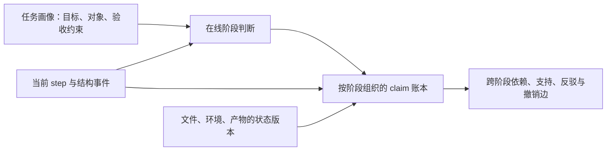

# 数据集任务标注审计与 stage—账本设计

2026-11-12。本次先核实数据与任务定义，再提出结构设计；下面明确区分本地实测、论文规范和待验证提案。复查产物在 `eval/dataset_task_audit/`。

## 1. 结论

应该让任务目标、交付物与验收条件参与 stage 判断。目前只从最近四步的动作/观察预测二元边界，没有显式给模型任务画像；这与后续需要记录“哪个结论支持哪个任务决策”的账本不完全匹配。

但数据集的 `category` 不是 stage 类别，也不是足够精细的工作流程定义。我们需要区分：**任务属于什么领域、要完成什么工作、当前处于哪种工作阶段、哪些结论已经被后续依赖**。

建议的系统关系是：**任务画像约束阶段判断；stage 组织账本；结构事件持续更新 claim 与依赖边。** 时间上的树状目录与跨阶段依赖图同时保留，不能把相邻阶段自动连成因果关系。此为设计提案，尚未宣称已实现完整账本写入器。

## 2. 本地到底有多少数据

### CodeTraceBench

| 范围 | 轨迹 | SWE 系 | Terminal-Bench 系 | 用途/限制 |
| --- | ---: | ---: | ---: | --- |
| full | 3,316 | 646 | 2,670 | 完整发布 manifest，包含四种 agent |
| verified | 1,000 | 489 | 511 | full 的子集，不是独立测试集 |
| verified 的 OpenHands | 520 | 313 | 207 | 含缺路径和无法可靠对齐条目 |
| 当前训练/五折评价 | 461 | 276 | 185 | 严格对齐、424 个任务名，18,636 步 |

本地核对：verified 的全部 1,000 个轨迹 ID 都在 full 中，阶段标注相同。因此不能把两份相加当成 4,316 条独立轨迹。full 有 662 个任务名；一个任务可对应多个模型/agent 运行。任务组隔离仍然必要。

full 的 agent 数：OpenHands 1,242、mini-SWE-agent 1,024、Terminus2 923、SWE-agent 127。当前监督实验仅覆盖 OpenHands，不代表这四种接口都已验证。

`solved` 也有缺失：full 成功 1,307、失败 1,903、未知 106；verified 成功 504、失败 468、未知 28。当前 461 条为成功 263、失败 198。未知不能按失败处理；成功轨迹也可能含中途错误或无用步骤，不能把所有步骤都当“干净负样本”。

full 中有两条阶段覆盖异常，具体 ID 保存在报告。当前实验继续保留已有步号对齐和后缀动作审计约束，不因本次任务分类而把异常轨迹自动纳入训练。

### LongRCA

本地 full 共 1,140 条，mini 200 条全部包含于 full，内容与标注一致。

| 来源 | full 数量 | history 记录数中位数 | 本项目定位 |
| --- | ---: | ---: | --- |
| SWE-bench Pro | 128 | 257.5 | 编码任务长程根因/交接诊断候选 |
| Terminal-Bench 2 | 42 | 213.5 | 终端任务长程诊断候选 |
| TravelPlanner | 685 | 165 | 旅行约束与计划任务，第一版编码域之外 |
| VitaBench | 108 | 51 | 助手任务，需另定工作阶段 |
| WebArena Verified | 177 | 63 | 网页操作任务，需另定状态对象 |

若沿用总体设计的“第一版只做编码/终端域”，LongRCA 直接相关的是 **170 条**，不能把 1,140 条都称作编码任务。mini 每个来源各 40 条，它的来源比例不等于 full。

LongRCA 的 step 是一条带稳定索引的 history 记录，可为角色消息、工具调用、观察等；当前 CodeTraceBench 转换的 step 是配对后的动作与观察。二者不能按原始步数直接比较延迟、窗口长短或训练序列长度。[LongRCA 数据模式](https://arxiv.org/html/2608.15242v4#A4)

两个数据集都有 SWE-bench Pro 等来源，尚未完成跨数据集任务说明/仓库问题的映射去重，不能自动当作独立训练集和测试集。

## 3. 有哪些标注，能训练什么

| 信息 | CodeTraceBench 本地可用 | LongRCA 本地可用 | 使用边界 |
| --- | --- | --- | --- |
| 任务来源/领域 | task_name、category、tags、difficulty 等 | question_ID 来源前缀及原任务说明 | 是任务元数据，不是每步阶段标签 |
| 阶段区间 | stage_id、start_step_id、end_step_id | 无 | CodeTraceBench 可直接生成边界监督 |
| 每步工作阶段类别 | 论文定义了五类；当前 manifest 未保存类别名 | 无 | 目前不能直接构造可靠五分类训练集 |
| 错误步骤 | incorrect_step_ids；steps[].labels 为 incorrect | mistake_step 为一个根因步骤 | 全部错误与决定性根因不是同一目标 |
| 无用步骤 | unuseful_step_ids；对应 labels | 无独立此字段 | 不能由“非根因”推导“无用” |
| 责任角色 | manifest 无对应统一字段 | mistake_agent | LongRCA 的角色与根因步骤单独标注 |
| 根因解释 | 本地 manifest 无统一 reasoning 字段 | mistake_reason | 解释仅供监督/审查，不作在线输入 |
| 状态影响/工作阶段原分析 | 上游代码有读取接口，本地尚未找到对应原文件 | 无单独标签 | 不能把接口存在当作数据已经可用 |
| claim、依赖、反驳、接受时刻 | 无金标 | 无金标 | 都需要另行构建/验证，不能拿 stage 或根因步直接替代 |

CodeTraceBench full 的 `incorrect_stages.steps[].labels` 全量实际取值仅为 `incorrect`（17,701 个）或 `unuseful`（1,468 个），没有隐藏在该字段中的五类阶段名称。当前 461 条中有 542 个 incorrect、44 个 unuseful 标记。这些是公开标记集合，不应将未标记步骤自动解释成经过独立正确性认证。

LongRCA 的全部 1,140 条顶层字段一致：`question_ID/history/mistake_agent/mistake_step/mistake_reason`。history 仅有 `step/content/role/name`，未发现 stage 区间或类别字段。原论文也将其定位为完整失败轨迹的离线责任角色和根因定位；根因步骤与责任角色独立评分，解释在推断时隐藏。[LongRCA 论文与发布模式](https://arxiv.org/html/2608.15242v4#A4)

### 对“论文逐步打阶段标签”的进一步核验

CodeTracer 附录 A 确实描述了逐步分配环境检查、依赖安装、排查/调试、修改、验证五类标签，并将连续同类块划成区间，类别可以再次出现。[原标注规范](https://arxiv.org/html/2604.11641v1#A1)

但本地 full 的 22,246 个 stage 对象全部只有三个区间字段；3,316 条 `annotation_relpath` 指向的位置在当前数据根目录均不存在。按来源×agent 六个组合、每组取两个现存压缩包，检查了 12 个包，未发现按已知命名规则保存的 `step_N.jsonl`、阶段或标注文件；这些抽样包是原始运行产物。该抽样不能证明所有压缩包或上游私有标注都没有这些文件。

上游 `tree_builder.py` 明确尝试从 `step_N.jsonl` 读取 `llm_analysis.stage_label` 和 `command_impact`，说明存在另一层分析格式。它的字段名不能直接证明值域就是论文的五类或已经人工核验；拿到文件后仍需核对。[上游读取代码](https://github.com/NJU-LINK/CodeTracer/blob/main/src/codetracer/query/tree_builder.py)

因此，“论文采用逐步阶段标注”成立；“我们现在拥有可直接训练的逐步五类阶段标签”尚不成立。不能根据区间 stage_id=1、2、3 生成环境、安装、调试等类别。

## 4. 任务类型应怎样理解

CodeTraceBench full 的 646 条 SWE 轨迹全部标为 `software-engineering`。这个字段没有进一步区分接口兼容修复、构建修复、功能修改或重构，具体工作仍需读取任务说明。SWE 难度字段还有回填报告，不应把 easy/medium/hard 当作阶段或可靠的统一流程标签。

Terminal-Bench 覆盖 full 的 26 个原始 category 字符串；存在 `game/games`、`math/mathematics`、`file_operations/file-operations` 等别名，建议保留原字段并用带版本的映射规范化。`security`、`scientific-computing` 是领域标签，不足以决定工作方式：一个安全任务可能要求读日志、改代码或生成攻击样本，阶段过程会不同。

当前 185 条 Terminal-Bench 训练轨迹的实际分布：

| 原 category | 数量 | 本地任务例子 |
| --- | ---: | --- |
| software-engineering | 38 | 加入功能、转换或构建相关代码任务 |
| system-administration | 22 | build-initramfs-qemu、build-linux-kernel-qemu |
| debugging | 16 | fix-pandas-version、incompatible-python-fasttext |
| scientific-computing | 15 | adaptive-rejection-sampler、dna-assembly |
| data-science | 15 | causal-inference-r、pandas-sql-query |
| model-training | 12 | attention-mil、hf-lora-adapter |
| security | 11 | filter-js-from-html、git-workflow-hack |
| file-operations | 10 | db-wal-recovery、extract-elf |
| mathematics | 10 | mixed-integer-programming |
| machine-learning | 9 | caffe-cifar-10、模型转换 |
| 其余 13 个原 category | 27 | 游戏、数据处理、音视频、构建、助手等 |

这些计数是轨迹数，不是独立任务数。某些类别只有 1–2 条，当前不能为 23 类分别训练可靠划分模型，也不能把全量总 F1 当作每种任务都有效。

建议的任务画像是下面三层，而不是用 category 直接指定固定阶段顺序：

1. **领域 domain**：代码、数据、系统、科学计算等，用于解释场景。
2. **工作目标 family**：修改仓库、生成/转换产物、配置运行环境、执行计算/训练、满足规划约束、改变网页状态等。一个任务可有主目标和辅助目标。
3. **验收约束 success_contract**：要交付什么、保持什么不变、哪些证据才算完成。来源必须是任务开始时可见的要求，不能使用最终 solved、隐藏测试结果或根因解释。

例如修复 Numpy 兼容并编译 pyknotid，领域虽为科学计算，却同时包含仓库修改和环境构建。其阶段应受“现有 Numpy 版本保持不变、扩展可导入、指定测试通过”等条件约束，而不能看到 scientific-computing 就切成统一训练流程。本地 LongRCA `terminal_bench_2__001` 的用户说明可作为此类任务画像的实例。

## 5. 基于任务的 stage 定义提案

先保留可解释的工作模式，再结合当前目标和对象判断。表中是待验证的工程提案，不是数据已经提供的金标，也不是固定顺序：

| 工作目标 | 有意义的阶段活动示例 | 应进入账本的关键内容 |
| --- | --- | --- |
| 仓库修复/修改 | 环境确认、复现定位、修改、验证；失败后可以返回定位 | 失败现象、定位假设、接口约束、修改对象/版本、测试范围 |
| 数据/文件产物 | 来源检查、模式/格式确认、转换/合并、结果校验、交付 | 来源、schema、行数/单位、不变量、产物路径与版本 |
| 环境/系统配置 | 状态检查、约束与配置选择、安装/构建/变更、运行验证 | 包版本、配置项、系统状态、构建产物、健康检查 |
| 科学计算/训练 | 假设与输入准备、方法实现/配置、计算或训练、指标与约束验证 | 数学假设、参数、随机种子、数据范围、指标定义与结果 |
| 旅行/助手规划 | 约束提取、证据检索、候选方案、约束核对、确认 | 时间、预算、单位、来源、依赖假设；第一版暂不扩域 |
| 网页事务 | 定位对象、检查前置状态、执行动作、确认状态改变 | 对象 ID、前后状态、权限与可逆性；第一版暂不扩域 |

对于复现 CodeTracer 的阶段边界，仍以其标注粒度作为评价目标。任务画像帮助解释某次操作是在排查、安装还是验证，不能自行增加“每换文件就切”“每换子目标就切”的边界然后仍声称沿用原 benchmark 标准。若为账本需要引入更细粒度子目标，应作为单独层或明确的新阶段协议，另做标注/下游验收。

边界候选可以由公开计划活动切换、主要工作模式变化、处理对象/证据任务改变、交接和交付提出；最终是否成为 stage 取决于定义与前缀证据。具体约束：

- 同一排查过程里 grep→读取源码，不因换工具必然切分。
- 同样运行 pytest，修改前可用于复现/定位，修改后可用于验证；需要任务目标、历史和修改状态。
- 同一文件可以先定位、再修改、再验证；“文件没变”不能阻止阶段变化。
- 角色交接是明确事件，但不一定等于工作模式改变；保留 handoff 标记，不强制将两者视为同一标签。
- 阶段可跳过、反复出现；不强制环境→安装→调试→修改→验证各一次。
- 无法判断时保留暂定阶段和置信度，不借人工金标、完整轨迹长度或未来结果提前封口。

现有模型主要看局部动作/观察和结构特征，未显式使用任务目标与验收约束。下一轮应先建立这些输入与阶段字段，再决定是用结构模型、轻量编码器还是组合；本轮没有新增模型训练。

## 6. stage 怎样支撑账本树

建议在展示和存储上保留任务→阶段→claim 的层次，同时用显式边表达跨阶段的依赖。状态版本作为 claim/证据的引用对象，可以横跨多个阶段；一阶段也可以涉及多个状态版本。当前 `tree.py` 的“状态改变单元”不应直接改名成工作阶段。



建议最小字段：

- TaskProfile：domain、work_family、deliverables、success_contract、profile_source、version。
- Stage：stage_id、start/end_step_id、detected_at_step_id、work_kind、objective、artifact_scope、status（provisional/committed）、profile_version；无法监督的语义字段允许 unknown。
- Claim：claim_id、stage_id、type、subject、statement、scope、introduced_step、source_ref、evidence_refs、state_version_refs、依赖 ID、验证状态与采用状态。
- Edge：from/to、relation（supports/depends_on/contradicts/invalidates/reverts）、observed_step、证据指针、置信度。

验证状态与采用状态分开：agent 将计划项标为 done、引用某个结论，只能支持“该结论被采用”的记录；不能由此认定结论正确。测试通过也应绑定具体代码版本、环境和测试范围。

一个 SWE 示例（设计示意，不是新标注）：定位阶段提出“问题在参数解析”；修改阶段实施接口变更；验证阶段记录某组测试通过。账本分别保存定位假设、接口修改、测试结果，并记录修改依赖定位假设、测试覆盖的状态版本。若测试导入的是未修改的已安装包，它就不能支持“当前补丁正确”。后续再次修改文件时，旧测试结果保留，但对新版本的适用性需要重新判断。

**以 stage 组织账本，不意味着必须等 stage 结束才写账本。** 当前阶段内可增量写候选 claim；验证放行、引用、交接、不可逆动作应立即记录。stage 封口用于整理和核对证据，不能阻塞接受事件检测。否则最长阶段会吞掉需要干预的时间窗口。

此外，时间顺序不等于依赖关系：Stage 3 出现在 Stage 2 后面，不足以构造 depends_on。依赖应由明确引用、任务交接、产物消费或状态版本关系支持；仅共享路径是候选线索。

## 7. 现在能做什么、哪些监督仍缺失

本轮完成了本地全量字段与任务统计、子集重叠核验、12 个原始包的分层检查、上游逐步分析读取接口核查。未改变当前阶段金标、旧五折或线上划分行为。此前启动的 ModernBERT 原协议微调仍在运行，它只是旧输入条件下的对照，不等于本方案已实现。

建议执行顺序：

1. 固定 coding/terminal 为第一版范围；保留原 category，并建立任务画像字段与来源指针。先使用任务开始可见的说明、公开计划、工具信息，不读最终评测结果。
2. 将已恢复的公开计划输入做版本化接入；修复转换器后重新生成特征与缓存，不能把新输入静默交给旧模型。
3. 确认逐步五类阶段原标注能否取得。当前可直接做的监督是边界；若产生语义弱标签，必须标明生成规则/教师与不确定性，不能包装成人标。
4. 先完成任务→stage→claim/证据的可回读样例与协议，再实现增量写入和跨阶段关系。现有状态树、候选 claim 可复用，但完整账本写入器及其监督尚缺失。
5. 按任务工作目标分别评估阶段边界、提交延迟、阶段语义（取得标签后）、证据保留与依赖正确性，再做下游归因对照。单一总体边界 F1 不足以验证账本可用。

现有数据不直接提供 t_lock 或 claim 依赖金标，也不支持用 stage 起点代替接受时刻。LongRCA 的根因解释可用于离线审读与后续监督设计，但不能输入在线划分器。新阶段语义或账本关系的准确性，需要独立核验；用户暂不标注期间先交付结构协议与可复查弱标签，不宣称人工验收已经完成。

## 8. 复查入口

```powershell
.\.venv-encoder\Scripts\python.exe -m segmenter.audit_dataset_tasks --refresh
.\.venv-encoder\Scripts\python.exe -m segmenter.audit_annotation_archives
```

- `eval/dataset_task_audit/codetrace.json`：full/verified/OpenHands/当前 461 条的任务、类别、标签及覆盖统计，含 manifest SHA256。
- `eval/dataset_task_audit/longrca.json`：两个版本的来源、字段、记录长度、角色、根因索引与重叠核验，附本地任务样例。
- `eval/dataset_task_audit/archive_annotations.json`：12 个抽样包的选择方法、路径、文件数与候选标注检查。
- `segmenter/CONFIRMATION_AUDIT.md`：输入缺失、错误类型、延迟确认实验及限制。

论文/数据卡提供规范说明；所有本地计数来自本次扫描。任务画像、阶段语义扩展和账本字段是针对本项目的设计提案，不是论文已证明的性能结论。
